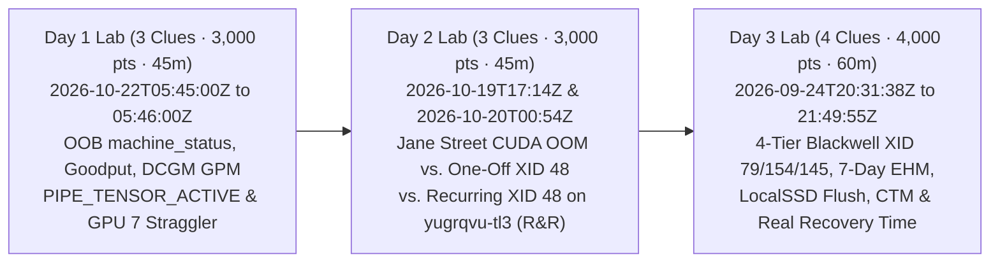

TL;DR: This guide provides the complete instructor answer key, timestamp-pinned Cloud Logging queries, and slide alignment map for the 3-Day (10-Breadcrumb) Read-Only Live Cloud Console GPU Reliability Detective Lab on `ikwak-reliability` (`2x a4-highgpu-8g`, 16x NVIDIA B200 GPUs). No pre-staging is required.

# Operation Goodput: 3-Day Live Cloud Console GPU Reliability Detective Lab Guide

> [!IMPORTANT]
> **Ready to Run Immediately (Zero Pre-Staging Required):**
> - **Web App URL:** `http://injaekwak.c.googlers.com:8787`
> - **Instructor Password (`Instructor Preview`, `Reveal Answer`, & `Reset Scoreboard`):** `ilovejensen`
> - **Zero Pre-Staging Needed:** Every question, hint, and copy-pasteable Cloud Logging query in the web app (`lab-webapp/index.html`) is pinned to the **exact UTC timestamps (`timestamp>="..." AND timestamp<="..."`)** where the errors and fault injections were recorded in Cloud Logging (`gpu-launchpad-playground`). You do **not** need to run `prestage-scenarios.sh` before the lab.
> - **Aligned 1-to-1 with Day 1, Day 2, and Day 3 Workshop Slide Decks:**
>   - [Day 1 Slides: Reliability Primer & Job Execution Observability](https://docs.google.com/presentation/d/1Zds3HF4fAX0xvIqYtR_Vk8gyHqMG8RtXlB4ziAg8dGE/edit#slide=id.slide_1792565293443516737_439)
>   - [Day 2 Slides: Infrastructure Crashes, Faulty Node R&R & Failure RCA](https://docs.google.com/presentation/d/1LsBIAEnhsVCTdnNoTWlpHtWJix7Ehqi-uwWg00_6g_M/edit#slide=id.slide_1792566224576935619_362)
>   - [Day 3 Slides: Hardware Failures (HotGPU & XIDs) & Emergent Maintenance](https://docs.google.com/presentation/d/1TUL-rBs0IcRi511u3HSQMiKJ5btZHOp0TTE1mdN3OhU/edit#slide=id.slide_1792566230641109874_378)
> - **Live Cluster:** `ikwak-reliability` (`europe-west4` / `europe-west4-b`, Project: `gpu-launchpad-playground`, Reservation: `nvidia-b200-6bsoymep8ylww`)
>   - **Node 1 (`-34t3`):** `gke-ikwak-reliabilit-a4-highgpu-8g-a4-0256e2f1-34t3` · GCE `instance_id="174490015860863227"` · Physical Machine in Veritas: `MACHINE:yugrqvu-tl3`
>   - **Node 2 (`-6df3`):** `gke-ikwak-reliabilit-a4-highgpu-8g-a4-0256e2f1-6df3` · GCE `instance_id="921428950843228374"`
> - **Live Investigation Surfaces:**
>   - [Cloud Logging (Logs Explorer)](https://console.cloud.google.com/logs/query?project=gpu-launchpad-playground)
>   - [GKE Cluster & Workloads Console](https://console.cloud.google.com/kubernetes/clusters/details/europe-west4/ikwak-reliability/details?project=gpu-launchpad-playground)
>   - [Veritas Machine View (`MACHINE:yugrqvu-tl3`)](https://data.corp.google.com/sites/vm_stability_gpu_cluster_datasite/gce_veritas_machine_view/?p=MACHINE:yugrqvu-tl3&p=DATE_FROM:2026-08-05&f=package_name_odbr7g:in:cloud-cluster-node-bundle-version,cloud-cluster-node-bundle-version-disruptive,cloud-gpu-drivervm,diorite-hma,firmware-hgx-endurance-msvfud,kernel_selector,platforms-bundle-version,platforms-bundle-version-disruptive,usps_promethium&av=bzgtll:85omjnu3&av=u81fwb:le8y8rev)
>   - [GCP GPU XID Troubleshooting Guide](https://docs.cloud.google.com/compute/docs/troubleshooting/troubleshooting-gpus#xid-handling)

---

## 1. Lab Structure & Permanent Injection Timestamps (3 Days · 10 Breadcrumbs · 10,000 Max Points)

All **10 Breadcrumbs** across **Day 1, Day 2, and Day 3** are backed by **permanent, already-recorded logs in Cloud Console (`gpu-launchpad-playground`)** on the `ikwak-reliability` cluster:

| Day | Breadcrumb ID | Slide Module Alignment | Recorded UTC Timestamp(s) in Cloud Logging | Log Stream / Resource |
| :--- | :--- | :--- | :--- | :--- |
| **Day 1** | **`d1-c1`** | Module 1.1 & 1.2A (Goodput & OOB vs. Coarse `GPU_UTIL`) | `2026-10-22T05:45:22.729Z` (`05:45:00Z` to `05:46:00Z`) | `k8s_container` · `pod_name="dapo-gemma3-straggler-driver"` |
| **Day 1** | **`d1-c2`** | Module 1.2A (Layer 2 In-Band DCGM GPM `PIPE_TENSOR_ACTIVE` & Power) | `2026-10-22T05:45:23.098Z` (`05:45:00Z` to `05:46:00Z`) | `k8s_container` · `pod_name="gpu-straggler-diag"` (Section `[1]`) |
| **Day 1** | **`d1-c3`** | Module 1.2B (Straggler Isolation: 1 Culprit vs. 15 Victims) | `2026-10-22T05:45:23.098Z` (`05:45:00Z` to `05:46:00Z`) | `k8s_container` · `pod_name="gpu-straggler-diag"` (Section `[2]`) |
| **Day 2** | **`d2-c1`** | Module 2.1 & 2.3 (Jane Street Lesson: Avoid False Eviction on App OOM) | `2026-10-19T17:14:21.788Z` & `2026-10-20T00:54:01.024Z` | `k8s_container` · `pod_name="dapo-gemma3-run1-driver"` |
| **Day 2** | **`d2-c2`** | Module 2.1 & 2.2 (Serial Console Hardware XID Forensics) | `2026-10-19T17:14:25.341Z` (`17:14:00Z` to `17:15:00Z`) | `gce_instance` (`serial_port_1_output`) · `instance_id="921428950843228374"` (Node `-6df3`) |
| **Day 2** | **`d2-c3`** | Module 2.2 & 2.3 (3-Branch R&R Decision Tree & Veritas `yugrqvu-tl3`) | `2026-10-20T00:54:06.584Z` to `00:54:10.660Z` | `gce_instance` (`serial_port_1_output`) · `instance_id="174490015860863227"` + Veritas `MACHINE:yugrqvu-tl3` |
| **Day 3** | **`d3-c1`** | Module 3.1A/B (4-Tier Blackwell XID Matrix: `79` + `154` + `145`) | `2026-09-24T20:31:38.086Z` to `20:31:38.906Z` | `gce_instance` (`serial_port_1_output`) · `instance_id="174490015860863227"` |
| **Day 3** | **`d3-c2`** | Module 3.2 (7-Day Proactive EHM `upcomingMaintenance`) | `2026-09-24T20:57:46.921Z` (`20:55:00Z` to `21:00:00Z`) | `gce_instance` (`cloudaudit.googleapis.com/system_event`) · `instance_id="174490015860863227"` |
| **Day 3** | **`d3-c3`** | Module 3.2 (LocalSSD Wipe Protection & CTM `perform-maintenance`) | `2026-09-24T20:57:59.327Z` to `20:57:59.837Z` | `k8s_cluster` & `gce_instance` (`cloudaudit.googleapis.com/activity`) |
| **Day 3** | **`d3-c4`** | Module 3.2 (Real Recovery Timeline & Beating the 4-Hour Window Trap) | `2026-09-24T21:12:19Z` to `21:49:55Z` & `2026-10-20T00:54:22Z` | `gce_instance` / `k8s_cluster` (`2026-09-24`) + `pod_name="dapo-run11-recovery-orchestrator"` |

---

## 2. Complete Instructor Answer Key & Timestamp-Scoped Cloud Logging Queries

### Day 1 Lab: Job Execution & Straggler Telemetry on B200 (`2026-10-22T05:45:22Z` to `05:45:23Z`)

| Clue ID | Title | Timestamp-Scoped Cloud Logging Query | Accepted Answers / Key | Core Takeaway |
| :--- | :--- | :--- | :--- | :--- |
| **`d1-c1`** | **Compare `DCGM_FI_DEV_GPU_UTIL` (`99.1%`) Against Actual Training Step-Time & Goodput** | `resource.type="k8s_container" AND resource.labels.cluster_name="ikwak-reliability" AND resource.labels.pod_name="dapo-gemma3-straggler-driver" AND timestamp>="2026-10-22T05:45:00Z" AND timestamp<="2026-10-22T05:46:00Z"` | `167.2`, `167`, `69.6`, `30.4`, `30%`, `1.44`, `9,830`, `9830` | Steps 1 to 5 run at `116.4s/step` (`100.0%` Goodput). At Step 6, step time slows to **`167.2s/step`** (`1.44x` slowdown, **`69.6%` Goodput** / **`30.4%` loss**) even while `DCGM_FI_DEV_GPU_UTIL` stays at `99.1%` because 15 healthy GPUs spin-poll inside NCCL collective wait kernels. |
| **`d1-c2`** | **Use `DCGM_FI_PROF_PIPE_TENSOR_ACTIVE` & `DCGM_FI_DEV_POWER_USAGE` to Separate Math from Spin-Wait** | `resource.type="k8s_container" AND resource.labels.cluster_name="ikwak-reliability" AND resource.labels.pod_name="gpu-straggler-diag" AND timestamp>="2026-10-22T05:45:00Z" AND timestamp<="2026-10-22T05:46:00Z"` | `68.1`, `68.1%`, `0.681`, `68`, `612`, `612w`, `612 w`, `273` | In Section `[1]` of `gpu-straggler-diag`, while `DCGM_FI_DEV_GPU_UTIL` stays at `99.1%`, Tensor Core active utilization (**`DCGM_FI_PROF_PIPE_TENSOR_ACTIVE`**) drops from `98.1%` (`0.981`) to **`68.1%` (`0.681`)** and average **`DCGM_FI_DEV_POWER_USAGE`** drops from `885 W` to **`612 W`**. |
| **`d1-c3`** | **Inspect Per-GPU `DCGM_FI_PROF_PCIE_RX_BYTES` & `POWER_USAGE` to Isolate the 1 Culprit GPU** | `resource.type="k8s_container" AND resource.labels.cluster_name="ikwak-reliability" AND resource.labels.pod_name="gpu-straggler-diag" AND timestamp>="2026-10-22T05:45:00Z" AND timestamp<="2026-10-22T05:46:00Z"` | `gpu 7`, `gpu7`, `7`, `0000:cc:00`, `cc:00`, `gen1`, `gen 1`, `pcie gen1`, `1.54`, `342`, `34t3` | Grouping `DCGM_FI_PROF_PCIE_RX_BYTES` and `DCGM_FI_DEV_POWER_USAGE` by GPU in Section `[2]` isolates **Node `-34t3` `GPU 7` (`0000:cc:00.0`)** at **`1.54 GB/s` (`PCIe Gen1 x16`, `12.8x` slower)** and **`342 W`** vs. `19.77 GB/s` (`PCIe Gen5 x16`) and `615 W` on the 15 victim GPUs. |

---

### Day 2 Lab: Infrastructure Crashes, Faulty Node R&R & Veritas Failure RCA (`2026-10-19T17:14Z` & `2026-10-20T00:54Z`)

| Clue ID | Title | Timestamp-Scoped Cloud Logging Query / Veritas Link | Accepted Answers / Key | Core Takeaway |
| :--- | :--- | :--- | :--- | :--- |
| **`d2-c1`** | **Incident #1 (Jane Street Lesson): Investigate Why `dapo-gemma3-run1` Died at Step 1** | `resource.type="k8s_container" AND resource.labels.cluster_name="ikwak-reliability" AND resource.labels.pod_name="dapo-gemma3-run1-driver" AND timestamp>="2026-10-19T17:14:00Z" AND timestamp<="2026-10-20T00:55:00Z"` | `oom`, `out of memory`, `outofmemoryerror`, `cuda out of memory`, `14.50` | `torch.OutOfMemoryError: CUDA out of memory. Tried to allocate 14.50 GiB` at Step 1 (`0` XID errors). Workload config error: never evict or R&R healthy hosts on app OOMs or app XIDs ($t_{re}=0$). |
| **`d2-c2`** | **Incident #2: Find the Exact XID Error Code on Node `-6df3`** | `resource.type="gce_instance" AND log_id("serialconsole.googleapis.com/serial_port_1_output") AND resource.labels.instance_id="921428950843228374" AND timestamp>="2026-10-19T17:14:00Z" AND timestamp<="2026-10-19T17:15:00Z" AND "NVRM: Xid"` | `48`, `xid 48`, `xid48`, `double bit ecc`, `dbe` | **`XID 48`** (`An uncorrectable double bit error (DBE) has been detected on GPU (0000:89:00)`) captured in `serialconsole.googleapis.com/serial_port_1_output` at `2026-10-19T17:14:25.341Z`. |
| **`d2-c3`** | **Incident #3: 3-Branch R&R Decision Tree & Veritas (`yugrqvu-tl3`) Recidivism Audit** | `resource.type="gce_instance" AND log_id("serialconsole.googleapis.com/serial_port_1_output") AND resource.labels.instance_id="174490015860863227" AND timestamp>="2026-10-20T00:54:00Z" AND timestamp<="2026-10-20T00:55:00Z" AND "NVRM: Xid" AND "48"` + Veritas `MACHINE:yugrqvu-tl3` | **Option B** | **Node `-6df3` (One-off `XID 48`):** In-place GPU reset, VM reboot (~35s), or `QUICK_DIAGNOSIS_RESET`. **Node `-34t3` / Host `yugrqvu-tl3` (5x recurring `XID 48` on `0000:cc:00` in Serial Console & Veritas):** Cordon/drain and invoke full Host Replacement (`reportHostAsFaulty` / `gcloud compute instances report-faulty-host`). |

---

### Day 3 Lab: 4-Tier Blackwell XID Matrix, 7-Day EHM & Real CTM Recovery Timeline (`2026-09-24T20:31:38Z` to `21:49:55Z`)

| Clue ID | Title | Timestamp-Scoped Cloud Logging Query | Accepted Answers / Key | Core Takeaway |
| :--- | :--- | :--- | :--- | :--- |
| **`d3-c1`** | **Classify the Real `2026-09-24` `XID 79` -> `XID 154` -> `XID 145` Cascade** | `resource.type="gce_instance" AND log_id("serialconsole.googleapis.com/serial_port_1_output") AND resource.labels.instance_id="174490015860863227" AND timestamp>="2026-09-24T20:31:00Z" AND timestamp<="2026-09-24T20:33:00Z" AND "NVRM: Xid"` | `79`, `xid 79`, `xid79`, `fallen off the bus`, `154`, `xid 154`, `node reboot required`, `145`, `49`, `xid 49` | At `2026-09-24T20:31:38.086Z`, GPU 7 (`0000:cc:00`) emitted Tier 3 Fatal HW **`XID 79` (`GPU has fallen off the bus`)**, followed 0.65s later by Tier 2 Blackwell **`XID 154` (`Node Reboot Required`)** and Tier 4 **`XID 145` (NVLink)**. |
| **`d3-c2`** | **Verify the 7-Day EHM Notification in Cloud Audit Logs (`2026-09-24T20:57:46Z`)** | `resource.type="gce_instance" AND log_id("cloudaudit.googleapis.com/system_event") AND resource.labels.instance_id="174490015860863227" AND timestamp>="2026-09-24T20:55:00Z" AND timestamp<="2026-09-24T21:00:00Z"` | `upcomingmaintenance`, `compute.instances.upcomingmaintenance`, `failure_gpu_xid`, `failure_gpu`, `urgent repair`, `unscheduled` | At `2026-09-24T20:57:46.921Z` (`+26m 09s`), GCE logged `compute.instances.upcomingMaintenance` (`UNSCHEDULED`, `PENDING`, `canReschedule: true`, `maintenanceReasons: ["FAILURE_GPU_XID", "FAILURE_GPU"]`, default window 7 days out at `2026-10-02T00:00:00Z`). |
| **`d3-c3`** | **Flushing Ephemeral LocalSSD & Triggering CTM (`2026-09-24T20:57:59Z`)** | `(resource.type="k8s_cluster" OR resource.type="gce_instance") AND log_id("cloudaudit.googleapis.com/activity") AND timestamp>="2026-09-24T20:57:00Z" AND timestamp<="2026-09-24T21:00:00Z"` | **Option C** | Flush checkpoints from ephemeral `/mnt/localssd` to Lustre/GCS (since host migration triggers `localSsdRecoveryTimeoutError`), then apply `kubectl label node <NODE> cloud.google.com/perform-maintenance=true` (`20:57:59.327Z`), which invokes `v1.compute.instances.performMaintenance` in `0.51s`. |
| **`d3-c4`** | **Calculate Real Host Replacement, Ray (`2/2`) & Job Recovery Time (`2026-09-24T20:57:59Z` to `21:49:55Z`)** | `resource.type="k8s_container" AND resource.labels.cluster_name="ikwak-reliability" AND resource.labels.pod_name="dapo-run11-recovery-orchestrator" AND timestamp>="2026-10-20T00:53:00Z" AND timestamp<="2026-10-20T00:55:00Z"` | `35`, `35m`, `35.4`, `39`, `40`, `39m`, `40m`, `12`, `12m`, `51`, `52`, `52m`, `78`, `78m`, `1h 18m`, `33m` | **GKE Node `Ready=True` (8/8 GPUs):** **`35m 25s`** (`21:33:24Z`). **Ray `2/2` Healthy:** **`39m 43s`** (`21:37:42Z`). **Training `Step 1/500` Resumed:** **`12m 13s`** after Ray healthy (**`51m 56s`** after CTM trigger / **`78m`** total from fault, `21:49:55Z`), beating the 4-hour `windowEndTime` lag by `3h 24m`. |
