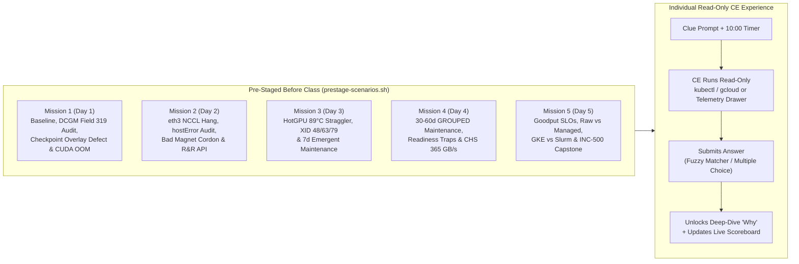

# Interactive CE Breadcrumb Lab: "Operation Goodput" (5-Day Self-Paced Forensic Edition)

This guide accompanies the **Operation Goodput Interactive Web App** ([index.html](file:///usr/local/google/home/rickruguichen/jetski-playground/reliability/lab-webapp/index.html)), the **Live Scoreboard Server** ([server.py](file:///usr/local/google/home/rickruguichen/jetski-playground/reliability/lab-webapp/server.py)), and the **Hands-Off Pre-Staging Script** ([prestage-scenarios.sh](file:///usr/local/google/home/rickruguichen/jetski-playground/reliability/lab-webapp/prestage-scenarios.sh)).

It is aligned **1:1 with Days 1–5 and Column F (Critical User Journeys)** of the **5-Day Session Plan (`gid=1288298866`)**, designed for a **100% Read-Only / Demo-Based** Customer Engineer (CE) experience.

---

## 1. Lab Architecture: Self-Paced, 100% Read-Only, and Pre-Staged

To make the lab maximally interactive for Customer Engineers (CEs) on a single shared read-only cluster **without** allowing or requiring any CE to create/mutate compute resources or peek at other participants' answers:

1. **100% Read-Only / Demo-Based Investigation:**
   * CEs only execute read-only `kubectl get/describe/logs`, `gcloud compute instances/reservations describe`, and `gcloud logging read` commands—or inspect the built-in **`📟 View Captured Cluster Telemetry`** drawer on every question.
   * No CE ever creates VMs, pods, or reservations. Where a remediation action is required (such as `kubectl cordon`, `report-faulty-host`, or `cloud.google.com/perform-maintenance=true`), CEs diagnose the read-only forensic telemetry and identify the exact command or operational decision gate.
2. **Individual Self-Paced Web App + Real-Time Scoreboard (`20,000 pts` max):**
   * Progress is tracked individually per browser (`localStorage`) across **5 Missions × 4 Breadcrumbs = 20 Breadcrumbs**.
   * Each breadcrumb has a **10:00 countdown timer** (`1,000 pts` scaling linearly down to `0 pts`) and syncs to the real-time leaderboard (`GET/POST /api/scoreboard`).
   * Instructors can unlock any stuck CE's question (`🔓 Reveal Answer` for `0 pts`) or preview all 5 missions (`🔒 Instructor Preview: ON`) using the instructor password **`ilovejensen`**.
3. **Pre-Generated Forensic Crime Scenes (Zero Live Instructor Intervention):**
   * Run [prestage-scenarios.sh](file:///usr/local/google/home/rickruguichen/jetski-playground/reliability/lab-webapp/prestage-scenarios.sh) **once** before the workshop. All 5 missions' pods and forensic ConfigMaps coexist cleanly in the `default` namespace.



---

## 2. Alignment with the 5-Day Session Plan (Column F Critical User Journeys)

| Day & Session (Sheet `gid=1288298866`) | Column F Critical User Journeys (CUJs) | Self-Paced Lab Mission & Breadcrumbs (Read-Only) |
| :--- | :--- | :--- |
| **Day 1**<br>*1.1 Primer & Resiliency*<br>*1.2 Monitoring & ML Diagnostics*<br>*Day 1 Lab* | • Software-layer resiliency (brownout/blackout, async/hierarchical checkpointing) & defense-in-depth framing before hardware troubleshooting<br>• Key metrics for monitoring job execution, Dashboards, Metrics Explorer, APIs, Export to 3P<br>• Out-of-band vs. In-band metrics; GCE vs. GKE metrics; VM vs. Host vs. NVLink metrics<br>• Inspecting baseline job execution on the 2-node B200 cluster | **Mission 1 · Day 1 (`m1-c1` – `m1-c4`)**<br>• **1.1:** Inspect baseline step time (`116.39s`) & warm worker init overhead (`t_rm = 721.5s`).<br>• **1.2:** Audit GKE In-Band DCGM (21 utilization families, missing `DCGM_FI_DEV_XID_ERRORS` field `319`) vs. GCE Out-of-Band / CLAM metrics.<br>• **1.3:** Uncover the silent checkpoint defect (`overlay` FS + incomplete `tmp_step_10` rename + `49.14s` blocking save vs. async GCS FUSE/Lustre).<br>• **1.4:** Triage `dapo-gemma3-run1-driver` (`torch.OutOfMemoryError: CUDA out of memory`, `t_re = 0`). |
| **Day 2**<br>*2.1 Job Crashes & Infra Issues*<br>*2.2 Faulty Node & R&R API*<br>*2.3 RCA (Veritas + CLAM)*<br>*Day 2 Lab* | • Detecting a job crash; Key logs and metrics for job crash, VM failures, NCCL hangs; Google-detected infrastructure issue<br>• Detecting a failure; Draining/cordoning node & calling `report-faulty-host` API (R&R)<br>• Investigating unplanned VM terminations and `hostError` events using Veritas & CLAM + Customer escalation example (bad node isolation) | **Mission 2 · Day 2 (`m2-c1` – `m2-c4`)**<br>• **2.1:** Pinpoint gIB RDMA NIC `eth3` (`mlx5_1`, `Rank 9`) in an NCCL `ALLREDUCE` collective watchdog timeout vs. fast RPC crash.<br>• **2.2:** Identify unplanned physical host failure via Cloud Audit Log `compute.instances.hostError` & correlate with Veritas/CLAM.<br>• **2.3:** Break the "bad magnet" scheduling loop (`kubectl cordon` + `kubectl drain` *before* pod deletion or R&R).<br>• **2.4:** Use `report-faulty-host` (`instances.reportHostAsFaulty` with `faultReasons`) for customer-detected faulty hosts when `upcomingMaintenance` is `null`. |
| **Day 3**<br>*3.1 HotGPU, CLAM & XIDs*<br>*3.2 Emergent Maintenance*<br>*Day 3 Lab (B200 XID Demo)* | • Identifying GPU thermal throttling (HotGPU node vs. rack issues), decoding NVIDIA XID errors, and correlating CLAM metrics<br>• Handling 7-day `UNSCHEDULED` emergent maintenance alerts in Cloud Logging and initiating Customer-Triggered Maintenance (`perform-maintenance` API)<br>• End-to-end B200 XID failure → Cloud Logging → repair node → resume job | **Mission 3 · Day 3 (`m3-c1` – `m3-c4`)**<br>• **3.1:** Diagnose a `1.44×` step slowdown (`167.2s/step`) caused by `GPU 3` thermal throttling (`89°C`, `540 MHz`, `HW_THERMAL_SLOWDOWN`) and distinguish single-GPU/node vs. rack cooling.<br>• **3.2:** Query `serialconsole.googleapis.com/serial_port_1_output` for `"NVRM: Xid"` to catch `XID 48` and apply the XID 48 vs. 3× `XID 63` rules.<br>• **3.3:** Trace `XID 79` (`GPU has fallen off the bus`) + `XID 154` to Reservation `DEGRADED` (30.4s) & 7-day `UNSCHEDULED` `FAILURE_GPU_XID` Emergent Maintenance.<br>• **3.4:** Pull repair forward via `cloud.google.com/perform-maintenance=true` (~35m in-place host repair). |
| **Day 4**<br>*4.1 Overall Cluster Health & Planned Maintenance*<br>*Day 4 Lab* | • Cluster/Nodepool Upgrade Strategies (Training vs. Inference); Maintenance Exclusion<br>• 30–60 day maintenance visibility, group vs. staggered maintenance, and post-maintenance Cluster Health Scanner / NCCL validation<br>• Querying upcoming 30–60d maintenance, triggering `perform-maintenance`, and verifying post-maintenance health | **Mission 4 · Day 4 (`m4-c1` – `m4-c4`)**<br>• **4.1:** Audit 30–60d `upcomingGroupMaintenance` (`PLANNED_UPDATE`) and `schedulingType: GROUPED` vs. `INDEPENDENT`.<br>• **4.2:** Avoid the `-5.5m` Reservation `HEALTHY` trap and `+4h` `windowEndTime` `ONGOING` trap by gating on `lastStartTimestamp` + `Ready=True|8 GPUs`.<br>• **4.3:** Validate post-maintenance node health via Cluster Health Scanner (CHS) & 16-GPU `all_reduce_perf` (`365.4 GB/s` busbw `PASS`).<br>• **4.4:** Choose Upgrade & Maintenance Exclusion policies for Synchronous Training (`GROUPED` + Exclusions) vs. Inference (Rolling Surge + PDBs). |
| **Day 5**<br>*5.1 Best Practices: SLA/SLO, Raw vs. Managed, K8s vs. Slurm*<br>*Day 5 Lab (Capstone)* | • SLA/SLO considerations with GPUs<br>• Raw vs. Managed mode (`A3 Ultra`/`A4` vs. `A4X NVL72`)<br>• K8s vs. Slurm (~30 mins on Slurm features & operational gaps)<br>• Final guided end-to-end troubleshooting walkthrough & wrap-up | **Mission 5 · Day 5 (`m5-c1` – `m5-c4`)**<br>• **5.1:** Connect Runtime Goodput / ETTR (`>90%` SLO) to cutting outage time from `16h 04m` (Run 7) to `1h 18m 18s` / `78m` (Run 11, `-92%`).<br>• **5.2:** Compare HA (Managed) Mode vs. All Capacity (Raw) Mode across 8-GPU `A3U/A4` hosts and 72-GPU `A4X NVL72` racks.<br>• **5.3:** Map Slurm primitives (`sbatch`, `Prolog`/`Epilog`, `scontrol drain`) to GKE equivalents (`Kueue` + `JobSet`, `CHS` + `NPD`, `kubectl cordon`).<br>• **5.4:** Solve Capstone Incident `INC-500` (NCCL timeout $\to$ 3× `XID 63` + `XID 64` bank exhaustion $\to$ `perform-maintenance=true` $\to$ `lastStartTimestamp` gate $\to$ CHS check $\to$ GCS FUSE checkpoint resume). |

---

## 3. One-Time Instructor Setup (Before the Lab)

### Step A: Grant Read-Only IAM Roles to CEs
Grant your CE participant group read-only visibility into the GKE cluster, Compute Engine reservations/instances, Cloud Logging, and Cloud Monitoring:

```bash
PROJECT="gpu-launchpad-playground"
CE_GROUP="group:ce-reliability-lab@google.com"

for ROLE in \
  roles/container.viewer \
  roles/compute.viewer \
  roles/logging.viewer \
  roles/monitoring.viewer; do
  gcloud projects add-iam-policy-binding "$PROJECT" \
    --member="$CE_GROUP" --role="$ROLE"
done
```
*(`roles/container.viewer` allows CEs to run `kubectl get`, `kubectl describe`, and `kubectl logs`, while strictly blocking `kubectl label`, `kubectl delete`, `kubectl cordon`, `kubectl apply`, and `kubectl exec`.)*

### Step B: Run the Pre-Staging Script Once
Run [prestage-scenarios.sh](file:///usr/local/google/home/rickruguichen/jetski-playground/reliability/lab-webapp/prestage-scenarios.sh) to stage all 5 missions' read-only pods and ConfigMaps in the `default` namespace:

```bash
bash reliability/lab-webapp/prestage-scenarios.sh
```

### Step C: Launch the Web App & Live Scoreboard Server
```bash
PORT=8787 python3 reliability/lab-webapp/server.py
```

---

## 4. Complete Instructor Answer Key (All 20 Breadcrumbs)

| Breadcrumb ID | Title | Input Type | Accepted Answer / Correct Choice |
| :--- | :--- | :---: | :--- |
| **`m1-c1`** | Baseline Step Time & Worker Init (`t_rm`) | Text | `116.39`, `116.4`, `116`, `721.5`, `721`, `12m 01s` |
| **`m1-c2`** | GKE In-Band DCGM Missing Field vs. Out-of-Band | Text | `319`, `DCGM_FI_DEV_XID_ERRORS`, `ECC`, `row remap` |
| **`m1-c3`** | Silent Checkpoint Defect Audit | Text | `overlay`, `tmp_step_10`, `gcsfuse`, `lustre`, `rename`, `Errno 24` |
| **`m1-c4`** | Incident #101 (`dapo-gemma3-run1` CUDA OOM) | Choice | **Option C** (`t_re = 0`; reduce batch/seq config or enable activation checkpointing) |
| **`m2-c1`** | NCCL Collective Stall (`dapo-gemma3-run2-nccl-stall`) | Text | `eth3`, `Rank 9`, `mlx5_1`, `10.88.2.7`, `ALLREDUCE`, `watchdog` |
| **`m2-c2`** | Unplanned VM Termination (`hostError` Audit Log) | Text | `compute.instances.hostError`, `hostError`, `automaticRestart` |
| **`m2-c3`** | Breaking the "Bad Magnet" Node Loop | Choice | **Option B** (`kubectl cordon <NODE>` + `kubectl drain` *before* pod deletion or R&R) |
| **`m2-c4`** | Customer-Detected Faulty Host Reporting (R&R API) | Text | `report-faulty-host`, `reportHostAsFaulty`, `fault-reasons` |
| **`m3-c1`** | HotGPU Thermal Straggler (`1.44×` Slowdown) | Text | `GPU 3`, `89`, `540`, `HW_THERMAL_SLOWDOWN`, `isolated`, `single` |
| **`m3-c2`** | Serial Console Log ID & XID 48 vs. 63 | Text | `serialconsole.googleapis.com/serial_port_1_output`, `XID 48`, `48` |
| **`m3-c3`** | Catastrophic `XID 79` & 7-Day Emergent Maintenance | Text | `FAILURE_GPU_XID`, `FAILURE_GPU`, `XID 79`, `79` |
| **`m3-c4`** | Customer-Triggered Maintenance Label & Repair Time | Text | `cloud.google.com/perform-maintenance=true`, `perform-maintenance`, `35m` |
| **`m4-c1`** | 30–60d Planned Maintenance & `schedulingType` | Text | `GROUPED`, `PLANNED_UPDATE`, `upcomingGroupMaintenance` |
| **`m4-c2`** | Post-Maintenance Readiness Traps (+4h vs. +35m) | Text | `lastStartTimestamp`, `in-place`, `Ready`, `8`, `True|8` |
| **`m4-c3`** | Cluster Health Scanner (CHS) & NCCL Bandwidth | Text | `365.4`, `365.36`, `365`, `PASS`, `all_reduce_perf`, `Cluster Health Scanner` |
| **`m4-c4`** | Upgrade Strategy: Training vs. Inference | Choice | **Option B** (`GROUPED` + Maintenance Exclusions for Training; Rolling Surge + PDBs for Inference) |
| **`m5-c1`** | GPU Goodput SLO & Run 11 End-to-End Recovery | Text | `1h 18m`, `78`, `92%` |
| **`m5-c2`** | Raw (All Capacity) vs. Managed (HA) Mode (`A3U/A4` vs `A4X`) | Choice | **Option B** (Managed = Google spare swaps; Raw = 100% capacity exposed for customer standby pools & NVL72 control) |
| **`m5-c3`** | GKE vs. Slurm Reliability Primitives | Text | `Kueue`, `JobSet`, `Node Problem Detector`, `NPD`, `Cluster Health Scanner`, `CHS` |
| **`m5-c4`** | Final Capstone Incident (`INC-500`: 3× XID 63 + XID 64) | Choice | **Option C** (Cordon + `perform-maintenance=true` now $\to$ gate on `lastStartTimestamp` + `Ready|8 GPUs` $\to$ CHS check $\to$ resume from GCS FUSE checkpoint) |
