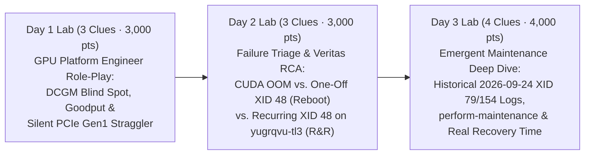

# Operation Goodput: 3-Day Live Cloud Console GPU Reliability Detective Lab Guide

> [!IMPORTANT]
> **Live Web App & Real-Time Scoreboard (Port `8787`):**
> - **Web App URL:** `http://injaekwak.c.googlers.com:8787`
> - **Instructor Password (`Instructor Preview`, `Reveal Answer`, & `Reset Scoreboard`):** `ilovejensen`
> - **Live Cluster:** `ikwak-reliability` (`europe-west4` / `europe-west4-b`, Project: `gpu-launchpad-playground`, Reservation: `nvidia-b200-6bsoymep8ylww`)
>   - **Node 1 (`-34t3`):** `gke-ikwak-reliabilit-a4-highgpu-8g-a4-0256e2f1-34t3` · GCE `instance_id="174490015860863227"` · Physical Machine in Veritas: `MACHINE:yugrqvu-tl3`
>   - **Node 2 (`-6df3`):** `gke-ikwak-reliabilit-a4-highgpu-8g-a4-0256e2f1-6df3` · GCE `instance_id="921428950843228374"`
> - **Live Investigation Surfaces:**
>   - [Cloud Logging (Logs Explorer)](https://console.cloud.google.com/logs/query?project=gpu-launchpad-playground)
>   - [GKE Cluster & Workloads Console](https://console.cloud.google.com/kubernetes/clusters/details/europe-west4/ikwak-reliability/details?project=gpu-launchpad-playground)
>   - [Veritas Machine View (`MACHINE:yugrqvu-tl3`)](https://data.corp.google.com/sites/vm_stability_gpu_cluster_datasite/gce_veritas_machine_view/?p=MACHINE:yugrqvu-tl3&p=DATE_FROM:2026-08-05&f=package_name_odbr7g:in:cloud-cluster-node-bundle-version,cloud-cluster-node-bundle-version-disruptive,cloud-gpu-drivervm,diorite-hma,firmware-hgx-endurance-msvfud,kernel_selector,platforms-bundle-version,platforms-bundle-version-disruptive,usps_promethium&av=bzgtll:85omjnu3&av=u81fwb:le8y8rev)
>   - [GCP GPU XID Troubleshooting Guide](https://docs.cloud.google.com/compute/docs/troubleshooting/troubleshooting-gpus#xid-handling)

---

## 1. Lab Structure Overview (3 Days · 10 Breadcrumbs · 10,000 Max Points)

All **10 Breadcrumbs** across **Day 1, Day 2, and Day 3** are backed by **real, live logs and metrics in Cloud Console (`gpu-launchpad-playground`)** generated and verified on the `ikwak-reliability` cluster:



---

## 2. Pre-Staging / Refreshing Live Breadcrumbs on `ikwak-reliability`

All historical `2026-09-24` Run 11 hardware fault, Emergent Maintenance, and node replacement logs are permanently stored in Cloud Logging on `instance_id="174490015860863227"`. To ensure the Kubernetes pods and fresh serial console entries for Day 1, Day 2, and Day 3 are active before a session, run:

```bash
bash /usr/local/google/home/ikwak/jetski-playground/reliability/lab-webapp/prestage-scenarios.sh
```

This creates/refreshes the following read-only pods in the `default` namespace (whose stdout logs are indexed in Cloud Logging under `resource.type="k8s_container"`) and emits the one-off vs. recurring `XID 48` serial console breadcrumbs:
- **Day 1 Pods:** `dapo-gemma3-straggler-driver`, `gpu-straggler-diag`
- **Day 2 Pods & Serial Console Logs:** `dapo-gemma3-run1-driver`, `dapo-gemma3-run2-driver` (+ 1× `XID 48` on `-6df3` / `921428950843228374`), `dapo-gemma3-run2b-recurring-driver` (+ 5× recurring `XID 48` on `-34t3` / `174490015860863227` / `yugrqvu-tl3`)
- **Day 3 Pods & Historical `2026-09-24` Logs:** `dapo-gemma3-run3-driver`, `dapo-run11-recovery-orchestrator` (+ real `2026-09-24T20:31:38Z..21:50:00Z` logs on `174490015860863227`)

---

## 3. Complete Instructor Answer Key & Live Cloud Logging Queries

### Day 1 Lab: Role-Playing a GPU Platform Engineer — Cloud Console Observability, Goodput & Silent Brownouts

| Clue ID | Title | Cloud Logging (Logs Explorer) Query | Accepted Answers / Key | Core Takeaway |
| :--- | :--- | :--- | :--- | :--- |
| **`d1-c1`** | **Audit the Live Cluster & Default GKE Managed DCGM Exporter Blind Spot** | `resource.type="k8s_container" AND resource.labels.cluster_name="ikwak-reliability" AND resource.labels.pod_name="gpu-straggler-diag"` | `0`, `zero`, `none`, `319`, `dcgm_fi_dev_xid_errors`, `xid_errors`, `21`, `16` | Default GKE Managed DCGM exports `21` metric families (`168` series/node) for utilization/clocks/memory, but **`0` error metric families** (`DCGM_FI_DEV_XID_ERRORS` Field `319` is omitted). Also, `DCGM_FI_DEV_GPU_UTIL` stays ~99% during a straggler stall because healthy GPUs spin-wait inside NCCL barriers. |
| **`d1-c2`** | **Measure the Silent Brownout Goodput Loss in `dapo-gemma3-straggler-driver`** | `resource.type="k8s_container" AND resource.labels.cluster_name="ikwak-reliability" AND resource.labels.pod_name="dapo-gemma3-straggler-driver"` | `167.2`, `167`, `69.6`, `30.4`, `30%`, `1.44`, `9,830`, `9830` | Steps 1–5 run at `116.4s/step` (`100.0%` Goodput). At Step 6, step time degrades to **`167.2s/step`** (`1.44×` slowdown), dropping Goodput to **`69.6%`** (**`30.4%` Goodput loss**) while `cluster_gpu_util` remains `99.1%` and `xid_errors: 0`. |
| **`d1-c3`** | **Identify Which GPU & Hardware Link Caused the 30.4% Goodput Brownout** | `resource.type="k8s_container" AND resource.labels.cluster_name="ikwak-reliability" AND resource.labels.pod_name="gpu-straggler-diag"` | `gpu 7`, `gpu7`, `7`, `0000:cc:00`, `cc:00`, `gen1`, `gen 1`, `pcie gen1`, `1.54`, `68.1`, `34t3` | On Node `-34t3`, **`GPU 7` (`0000:cc:00.0`)** down-trained from **PCIe Gen5 x16 (`19.77 GB/s` H2D)** to **PCIe Gen1 x16 (`1.54 GB/s` — `12.8×` slower)**, pulling Tensor Core utilization (`PIPE_TENSOR_ACTIVE`) down from `98.1%` to **`68.1%`** across the cluster. |

---

### Day 2 Lab: Troubleshooting Failures — CUDA OOM vs. XID 48 & Veritas Timeline RCA (Reset/Reboot vs. R&R)

| Clue ID | Title | Cloud Logging Query / Veritas Link | Accepted Answers / Key | Core Takeaway |
| :--- | :--- | :--- | :--- | :--- |
| **`d2-c1`** | **Incident #1: Investigate Why `dapo-gemma3-run1` Died at Step 1** | `resource.type="k8s_container" AND resource.labels.cluster_name="ikwak-reliability" AND resource.labels.pod_name="dapo-gemma3-run1-driver"` | `oom`, `out of memory`, `outofmemoryerror`, `cuda out of memory`, `14.50` | `torch.OutOfMemoryError: CUDA out of memory. Tried to allocate 14.50 GiB` at Step 1 (`0` XID errors). Application batch/context-length config bug — no hardware repair needed ($t_{re}=0$). |
| **`d2-c2`** | **Incident #2: Find the Exact XID Error Code on Node `-6df3` (`921428950843228374`)** | `resource.type="gce_instance" AND log_id("serialconsole.googleapis.com/serial_port_1_output") AND resource.labels.instance_id="921428950843228374" AND "NVRM: Xid"` | `48`, `xid 48`, `xid48`, `double bit ecc`, `dbe` | **`XID 48`** (`An uncorrectable double bit error (DBE) has been detected on GPU (0000:89:00)`) captured in `serialconsole.googleapis.com/serial_port_1_output`. |
| **`d2-c3`** | **Incident #3: Use Cloud Logging & Veritas (`yugrqvu-tl3`) to Decide: GPU Reset/Reboot vs. R&R** | `resource.type="gce_instance" AND log_id("serialconsole.googleapis.com/serial_port_1_output") AND resource.labels.instance_id="174490015860863227" AND "NVRM: Xid" AND "48"` + [Veritas `MACHINE:yugrqvu-tl3`](https://data.corp.google.com/sites/vm_stability_gpu_cluster_datasite/gce_veritas_machine_view/?p=MACHINE:yugrqvu-tl3&p=DATE_FROM:2026-08-05&f=package_name_odbr7g:in:cloud-cluster-node-bundle-version,cloud-cluster-node-bundle-version-disruptive,cloud-gpu-drivervm,diorite-hma,firmware-hgx-endurance-msvfud,kernel_selector,platforms-bundle-version,platforms-bundle-version-disruptive,usps_promethium&av=bzgtll:85omjnu3&av=u81fwb:le8y8rev) | **Option B** | • **Node `-6df3` (One-off `XID 48`):** Reset GPU (`nvidia-smi --gpu-reset`) or reboot VM (`cloud.google.com/perform-reboot=true`) (~35s).<br/>• **Node `-34t3` / Host `yugrqvu-tl3` (5× recurring `XID 48` on `0000:cc:00` in Serial Console & Veritas):** Cordon/drain and invoke **R&R (`gcloud compute instances report-faulty-host`)**. |

---

### Day 3 Lab: Emergent Maintenance Deep Dive — Historical `2026-09-24` Hard Failures, Node Repair & Real Recovery Timeline

| Clue ID | Title | Historical Cloud Logging Query (`2026-09-24`) | Accepted Answers / Key | Core Takeaway |
| :--- | :--- | :--- | :--- | :--- |
| **`d3-c1`** | **Dig Through Previous Serial Console Logs (`2026-09-24`) to Identify the Critical Hard XID Failure** | `resource.type="gce_instance" AND log_id("serialconsole.googleapis.com/serial_port_1_output") AND resource.labels.instance_id="174490015860863227" AND timestamp>="2026-09-24T20:31:00Z" AND timestamp<="2026-09-24T20:33:00Z" AND "NVRM: Xid"` | `79`, `xid 79`, `xid79`, `fallen off the bus`, `154`, `xid 154`, `node reboot required`, `145`, `49`, `xid 49` | At `20:31:38.086Z`, GPU 7 (`0000:cc:00`) emitted **`XID 79` (`GPU has fallen off the bus`)**, followed 0.65s later by **`XID 154` (`Node Reboot Required`)**, **`XID 145` (NVLink)**, and **`XID 45`**, killing the Ray training job in `9.4s`. |
| **`d3-c2`** | **Verify the Emergent Maintenance Notification in Cloud Audit Logs (`2026-09-24`)** | `resource.type="gce_instance" AND log_id("cloudaudit.googleapis.com/system_event") AND resource.labels.instance_id="174490015860863227" AND timestamp>="2026-09-24T20:55:00Z" AND timestamp<="2026-09-24T21:00:00Z"` | `upcomingmaintenance`, `compute.instances.upcomingmaintenance`, `failure_gpu_xid`, `failure_gpu`, `urgent repair`, `unscheduled` | At `20:57:46.921Z` (`+26m 09s`), GCE logged `compute.instances.upcomingMaintenance` (`UNSCHEDULED`, `PENDING`, `canReschedule: true`, `maintenanceReasons: ["FAILURE_GPU_XID", "FAILURE_GPU"]`, default window 7 days out at `2026-10-02T00:00:00Z`). |
| **`d3-c3`** | **What Is the Correct Action to Take for Hard GPU Failures Requiring Host Repair?** | `(resource.type="k8s_cluster" OR resource.type="gce_instance") AND log_id("cloudaudit.googleapis.com/activity") AND timestamp>="2026-09-24T20:57:00Z" AND timestamp<="2026-09-24T21:00:00Z"` | **Option C** | Apply `kubectl label node <NODE> cloud.google.com/perform-maintenance=true` (`20:57:59.327Z`), which invokes `v1.compute.instances.performMaintenance` (`20:57:59.837Z`) to pull the 7-day emergent maintenance window forward immediately (or call `report-faulty-host` if no pending window exists). |
| **`d3-c4`** | **Calculate How Long It Took to Replace the Node, Restore Ray (`2/2`) & Resume the Job** | `resource.type="k8s_container" AND resource.labels.cluster_name="ikwak-reliability" AND resource.labels.pod_name="dapo-run11-recovery-orchestrator"` | `35`, `35m`, `35.4`, `39`, `40`, `39m`, `40m`, `12`, `12m`, `51`, `52`, `52m`, `78`, `78m`, `1h 18m`, `33m` | • **VM Restarted on New Host (`restartOnANewMachineDueToRipTimeout` → `automaticRestart`):** `33m 19s` (`21:31:18Z`)<br/>• **GKE Node `Ready=True` (8/8 GPUs):** **`35m 25s` (`~35m`)** (`21:33:24Z`)<br/>• **Ray `2/2` Healthy (`lsfdm` pod Ready):** **`39m 43s` (`~40m`)** after label (`4m 18s` after Node Ready, `21:37:42Z`)<br/>• **Training `Step 1/500` Resumed (`dapo-run11-recovered`):** **`12m 13s` (`~12m`)** after Ray healthy (**`51m 56s` [`~52m`]** after `perform-maintenance` / **`1h 18m 18s` [`~78m`]** total from fault, `21:49:55Z`). |
